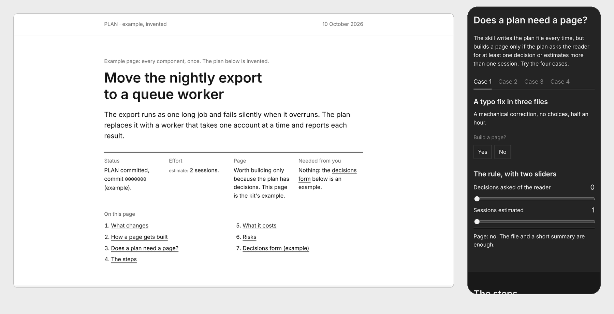
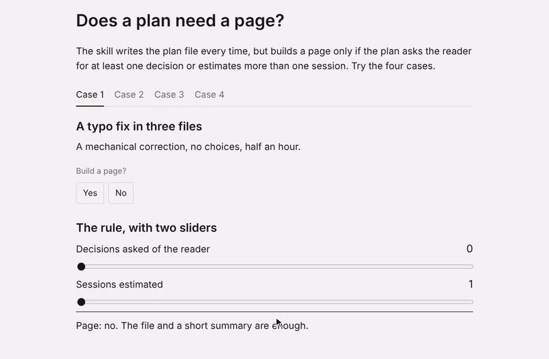
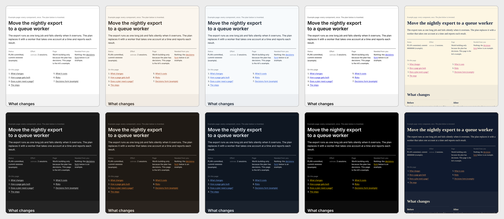

# explorable-plan

An agent skill that turns an agent's PLAN into a page you can explore: decisions up front, the mechanism
as a diagram, steps you click through, costs and risks in one place, and a form that composes your answer.
One self-contained HTML file, light and dark, readable on a phone.

It is written in the open [Agent Skills](https://agentskills.io) format, so any agent that loads `SKILL.md`
folders and can run shell commands can use it: Claude Code, Codex, Gemini CLI, GitHub Copilot, Cursor and
OpenCode among others. See [Install](#install) for where each one looks.



**Live example:** [the example page](https://backpropagation6.github.io/explorable-plan/) and
[the same plan with a custom theme](https://backpropagation6.github.io/explorable-plan/custom.html). The plan
in them is invented.

## Why

Agents write long plans. You then have three ways to deal with one, and none of them is good:

1) **Read all of it.** It is long, it is written for the agent as much as for you, and the one decision that
   needed you is somewhere in the middle.
2) **Ask for a summary.** It is short, and it drops exactly the detail you would have objected to.
3) **Approve and follow the diffs.** Every round you re-read the plan, the changes and the diffs to find out
   what moved, and you approve more than you checked.

The plan is not the problem. The format is. A plan is a set of things you need to see in different ways: a
choice, a mechanism, a sequence, a budget, a list of risks. Prose flattens all of them into the same
paragraphs.

This skill keeps the whole plan and changes how you get through it:

- **Decisions first.** The page opens with what is already decided and what is asked of you.
- **The mechanism as a picture.** A diagram for what changes and how the parts talk to each other.
- **Steps you can step through**, each with its safe state: where you can stop without breaking anything.
- **Costs and risks in one place**, charts always with their data table.
- **An answer you compose by clicking.** The decisions form writes the reply; you paste it into the chat.
- **Shareable.** It is one HTML file with no server and no build step for the reader. Send it to a colleague who
  was not in the session and they can follow it.

The plan file stays the source of truth. The page says which commit it reflects, and that the file wins if
the two differ. When you answer, your decisions go back into the plan file, not just into the chat.



## How it works

1) **The plan file comes first.** The agent writes the PLAN (format in
   [`references/plan-format.md`](references/plan-format.md)) and commits it.
2) **A page only when it earns one.** The skill builds a page if the plan asks you for at least one decision
   or estimates more than one session. Otherwise you get a short summary in the chat.
3) **It asks how the page should look, and waits.** Two questions: palette (neutral, warm, cool, high
   contrast, or your brand colours in hex) and type (system sans, serif or mono). Nothing is built in the same
   turn as the question. An unattended job cannot answer, so it builds no page and says so.
4) **It writes the content and builds the page** with `kit/build.py`. The page adds no numbers the plan does
   not already have.
5) **It checks the page in Chromium** with `kit/check.py`, light and dark, at desktop and phone width.
6) **It delivers it.** With a publishing tool (the Artifact tool in Claude Code) it publishes a private page;
   without one, you get the path of the file to open in a browser.
7) **A change is a new version, not an overwrite.** The plan file only grows: a change is a `## Version N`
   section at its end. The page is built into a new file (`name.v2.html`), republished at the same URL, and
   lists every version in its footer with its date, commit and what changed.



## Install

Copy this folder (without `.git/`) where your agent looks for skills, and keep its name: `explorable-plan`
must match the `name:` in `SKILL.md`.

| Agent | In a project | For all your projects |
| --- | --- | --- |
| Codex, Gemini CLI, GitHub Copilot, Cursor, OpenCode | `.agents/skills/explorable-plan/` | `~/.agents/skills/explorable-plan/` |
| Claude Code | `.claude/skills/explorable-plan/` | `~/.claude/skills/explorable-plan/` |

Claude Code does not read `.agents/skills/`. To serve every agent from one copy, put the folder in
`.agents/skills/` and link it from `.claude/skills/` (Claude Code follows a linked skill folder):

```
mkdir -p .claude/skills
ln -s ../../.agents/skills/explorable-plan .claude/skills/explorable-plan
```

Copilot, Cursor and OpenCode read `.claude/skills/` as well, so with the link they may list the skill twice.
If you only use those three and Claude Code, `.claude/skills/` alone is enough. Each agent also has a folder
of its own (`.gemini/skills/`, `.github/skills/`, `.cursor/skills/`, `.opencode/skills/`). Paths as documented
on 10 October 2026: [Claude Code](https://code.claude.com/docs/en/skills),
[Codex](https://developers.openai.com/codex/skills), [Gemini CLI](https://geminicli.com/docs/cli/skills/),
[GitHub Copilot](https://docs.github.com/en/copilot/concepts/agents/about-agent-skills),
[Cursor](https://cursor.com/docs/context/skills), [OpenCode](https://opencode.ai/docs/skills/).

Then ask for a plan as usual. [`SKILL.md`](SKILL.md) is the procedure the agent follows. Where it names a
Claude Code tool (AskUserQuestion, Artifact), it also says what to do without it: ask in the chat, hand over
the file.

**An agent that does not load skills** can follow the same procedure if its instructions file points to it.
Add a line like this to the file it reads (`AGENTS.md`, `GEMINI.md`, `CLAUDE.md`,
`.github/copilot-instructions.md`), with the path where you put the folder:

```
Before a non-trivial change, write a PLAN and follow .agents/skills/explorable-plan/SKILL.md.
```

Dependencies:

- **Python 3.8 or newer**, standard library only, for `kit/build.py`.
- **`pip install playwright`** and **`playwright install chromium`** for `kit/check.py`. Without them
  `check.py` still runs the source checks, says that the browser checks were NOT run, and exits with code 3,
  never 0.
- **A publishing tool** is optional: the Artifact tool in Claude Code, or your agent's own if it keeps the
  page private. With it the skill publishes the page, built with `--fragment` when the tool adds the document
  skeleton itself. Without it the skill builds a complete HTML document and gives you the file.
- **git**, for the commit the page reflects (`git rev-parse --short HEAD`).

## Use the kit without the skill

```
python3 kit/build.py examples/minimal.html out/minimal.html
python3 kit/check.py out/minimal.html out/minimal-check
```

Open `out/minimal.html` in a browser. `build.py` takes a content file (a metadata comment, then HTML) and
writes one page: by default a complete HTML document; with `--fragment` only the part that goes inside a
document, for a host that adds the skeleton itself (such as the Artifact tool; a fragment opened directly in a
browser runs in quirks mode and ignores the phone viewport). It creates the output folder if it is missing,
and never overwrites: it replaces an existing file only when that file holds the same version of the same
plan (a rebuild while you fix what `check.py` found), and stops, leaving the file as it is, on another
version, another plan, or a file it did not write. The error proposes the name to use (`name.v2.html`). `check.py` tests the file as delivered (a file that starts with
`<!doctype` is loaded as it is, anything else is wrapped in a skeleton first), prints `OK` and exits 0, or
lists the problems and exits 1. Write outputs outside your repository, or under `out/`, which `.gitignore`
covers.

The pages in `docs/` are the two examples, built with the same command (`docs/index.html` from
`examples/minimal.html`, `docs/custom.html` from `examples/minimal-custom.html`). They are served at fixed
URLs, so a new version of the examples replaces them on purpose: `build.py` refuses, you remove the two files
yourself and build again, and git keeps the earlier version.

## The content file

```
<!--plan
title: Name of 2-4 words
description: One sentence for the gallery card.
masthead: PLAN · short topic
date: 10 October 2026
plan: PLAN-topic-2026-10-10.md
commit: 0000000
theme: neutral
lang: en
versions: 1 2026-10-10 0000000 First plan.
-->
<main id="content"> ... </main>
```

One key per line; a line that starts with a space continues the previous key; an unknown or repeated key is
an error.

| Key | Required | Meaning |
| --- | --- | --- |
| `title` | yes | A name of 2-4 words (the gallery card title). |
| `description` | yes | One sentence for the card; goes in the `<meta name="description">`. |
| `masthead` | yes | The text at the top left of the page. |
| `date` | yes | Free text, shown at the top right. |
| `plan` | yes | Path of the PLAN file, shown in the footer. |
| `commit` | yes | Hex sha (7 to 40 characters, upper or lower case, kept in lower case) of the commit the page reflects. |
| `theme` | yes | A preset name (`neutral`, `warm`, `cool`, `high-contrast`) or `custom`. Write `theme: neutral` for the default look. |
| `lang` | no | `en` (default) or `it`: the language of the interface strings the kit writes. |
| `theme-colors` | with `custom` | Ink, paper and accent in hex, for light and for dark (below). Not allowed with a preset. |
| `theme-font` | no | `sans`, `serif` or `mono`: a system font stack. Overrides the preset's font. |
| `sources` | no | HTML for the footer. |
| `signature` | no | A line at the end of the footer. Empty by default. |
| `versions` | no | One line per version of the PLAN, oldest first: `<number> <YYYY-MM-DD> <commit> <what changed>`. Numbers run 1, 2, 3; dates never go back; commits are distinct and the last one is `commit:`. The masthead shows the version and the footer lists them all. Without it the page is version 1 and shows no version. |

A custom theme:

```
theme: custom
theme-colors: light ink=#14213d paper=#fdf6e3 accent=#b4236a
  dark ink=#f1e9d2 paper=#101a2e accent=#f4a261
theme-font: serif
```

`build.py` derives every other colour (secondary text, rules, washes, the dark band) from ink and paper, and
rejects a theme in which a text colour reads under 4.5:1 against its background in either mode: ink and
accent against paper and against the wash band, the derived secondary text, and the dark band. The message
names the mode and the pair. A preset can ask for more with `min_contrast` (high contrast uses 7).

The `<main id="content">` and everything after the metadata is yours. `<script>` blocks in it are moved after
`base.js` and can use `window.Plan` (`$`, `$$`, `el`, `fmt`, `dateLong`, `ui`, `initTabs`, `initSteps`,
`initDisc`, `initDecisions`). Any `%%` left in the finished page is an error: to write a literal `%%` in the
content, write `&#37;&#37;`. The content file may start with a byte order mark.

## Round trip

`build.py` keeps the content between sentinel comments and repeats the `<!--plan` block at the end of the
page. From a published page saved to a file (a complete document, a fragment, or a fragment inside another
skeleton):

```
python3 kit/build.py --extract page.html content.html
python3 kit/build.py content.html page2.html
```

The extracted content has the same metadata, so `theme:` and `lang:` come back with it, and `page2.html` is
identical to `page.html` (build both with the same `--fragment` choice: the mode is not stored in the page).
`--extract` follows the same no-overwrite rule as a build: it does not write over a content file that holds
another version.

## Themes

A preset is a JSON file in `kit/themes/`:

```json
{
  "label": "Neutral",
  "description": "Black, white and greys. The default.",
  "font": "sans",
  "min_contrast": 4.5,
  "colors": {
    "light": {"ink": "#171717", "paper": "#ffffff", "accent": "#171717"},
    "dark":  {"ink": "#f2f2f2", "paper": "#191919", "accent": "#f2f2f2"}
  },
  "forbidden": []
}
```

`colors.<mode>.paper` is the background `check.py` compares with the rendered page. `forbidden` is a list of
taste rules, empty in `neutral`; each entry is checked by `check.py` against one part of the page:

```json
{"name": "CSS gradient", "scope": "css", "pattern": "gradient\\s*\\(", "ignorecase": true}
```

`scope` is `css` (style blocks and style attributes), `source` (the page as written) or `text` (the page with
HTML entities decoded, which is what you want for a character such as a dash). To add a preset, add a file;
its name is the value of `theme:`.

Dark mode follows the reader's system. A host that sets `data-theme="light"` or `data-theme="dark"` on the
root element (`<html>`) forces the mode whatever the system says. The content wrapper carries
`data-plan-theme`, the name of the theme, which is a different attribute on purpose.

The type is one of three system font stacks. **Custom fonts are out of scope for v1**: the kit ships no font
files, and a font you embed yourself is on you for licence and weight.

## What `check.py` looks at

Source: title and description (in the head, or at the top of a fragment), no leftover placeholder, no external
resource (stylesheet, `@import`, `src` or `href` outside `<a>`) except scripts from a short list of CDNs, under
16 MB, a footer (an element with a `data-canonical` attribute holding a `<code>` with the commit), and the
theme's `forbidden` rules. Chromium, at 1280 and 390 px, light and dark: no JS error (after one, the
interaction is skipped), no horizontal scroll, the background the theme expects, the other mode's background
when `data-theme` on the root element says so, text contrast of at least 4.5:1, one H1, no bar wider than its
scale, every tab and disclosure opens, the "next" button of the steps ends (click cap), print shows every panel
and restores the state of before, and the page without JavaScript shows every panel and carries the right
`lang` and `data-plan-theme`. Every page load and click has a 5 s timeout.

It is a smoke test. It does not find a readable colour outside the theme, overlaps or cut-off labels: look at
the screenshots.

| Exit code | Meaning |
| --- | --- |
| 0 | `OK`. |
| 1 | Problems found, listed. |
| 2 | Usage error. |
| 3 | The browser checks did not run (no playwright, or no Chromium). Only the source checks ran. Not a pass. |

## Components

| Component | Markup |
| --- | --- |
| Section bands | `section.band`, `.band-wash`, `.band-dark`, with `.col` inside |
| Opening facts, contents | `dl.facts` with `div > dt + dd`; `ol.toc` |
| Two-column comparison | `.choices > div > h3 + p` |
| Large quote | `blockquote.pull > p + footer` (in a `.band-dark`) |
| Tabs | `.tabs > [role=tablist][hidden] > button[role=tab][aria-controls]`, then `.tabpanel[role=tabpanel][id][aria-labelledby]` |
| Steps | `.tabs.steps` with `.steps-nav` on the tablist, `.step-meta`, and `.step-ctrl.only-js > button[data-step=prev]`, `button[data-step=next]` |
| Disclosures | `.disc-group > h3.disc-h > button.disc-btn[aria-expanded][aria-controls]`, then `.disc-body[id]`; `data-start="closed"` closes all |
| Bar chart | `.bars[role=img] > .bar > .lab + .track > .seg.a / .seg.b[style="width:N%"] + .val`, then `.axis`; always with a table of the same data |
| Number table | `.scroll-x > table`, with `.num` on numeric cells |
| Check list | `ul.checks > li > .g + span`; `.ko` underlines the word |
| Diagram | inline SVG with the classes `.s-ink .s-muted .s-rule .f-paper .f-wash .f-ink .f-muted .t-muted`; `.diag-h` and `.diag-v` switch at 650 px |
| Verdicts (quiz) | a page script; see `.case`, `.choice`, `.action`, `.outcome` in the example |
| Decisions | `form.decisions[data-intro] > .decision[data-question]` with inputs, then `.decision.answer` with `.dec-out`, `.dec-copy`, `.dec-copied` |
| JS-only and no-JS | `.only-js`, `.only-nojs`, `.no-print` |

Colours come only from the theme variables (`--ink`, `--paper`, `--accent`, `--muted`, `--rule`, `--wash`):
a page that uses them follows the theme and both modes.

## Layout

```
SKILL.md                         the procedure; step 2 asks how the page should look
kit/base.html base.js            template and generic script
kit/build.py check.py            assemble and check
kit/themes/*.json                the four presets
examples/minimal.html            an invented PLAN, neutral theme
examples/minimal-custom.html     the same content, custom theme
references/plan-format.md        the PLAN format
docs/                            the two examples built, and the images of this README
```

## License

MIT, see [`LICENSE`](LICENSE).
